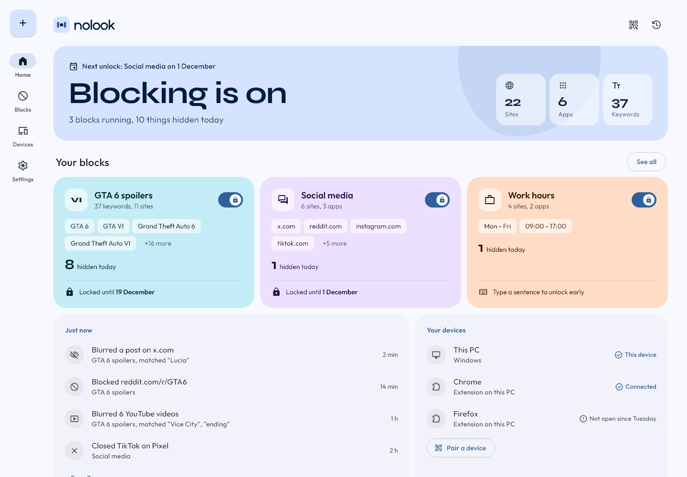
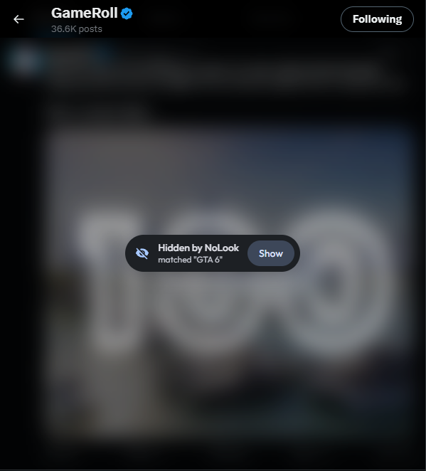
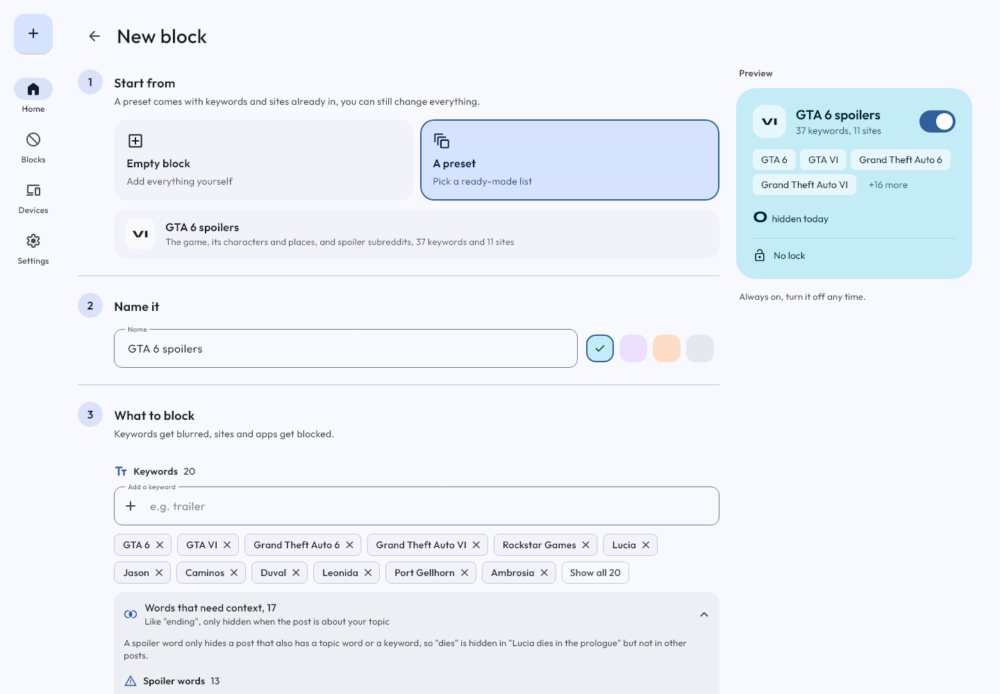
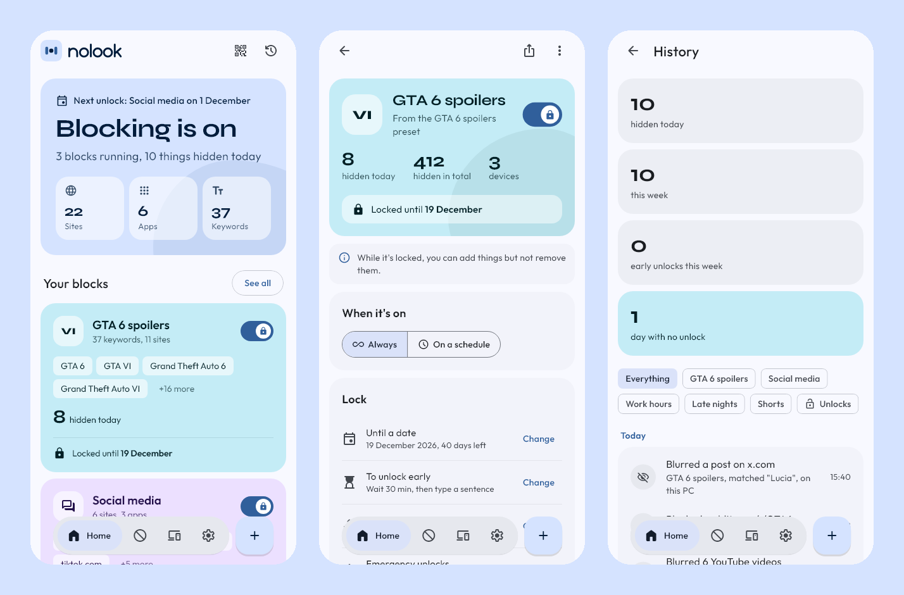

<p align="center">
  <picture>
    <source media="(prefers-color-scheme: dark)" srcset="docs/images/wordmark-white.svg">
    
  </picture>
</p>

<p align="center">Hide spoilers and block sites and apps on your PC, phone and browser.<br><a href="https://nolook.itszedk.com">nolook.itszedk.com</a></p>



NoLook lets you make blocks of keywords, websites and apps. When a block is on, matching posts and videos are blurred or hidden, blocked websites are stopped from opening, and selected apps can be closed.

You can make different blocks for different things, set a schedule for each one, or add a lock that makes it harder to switch off.

## Features

### Hide keywords and spoilers

NoLook checks posts, comments and videos for words you've added to a block. Matching content gets blurred or hidden, and you can click **Show** when you want to see it anyway.

Each block has three kinds of words:

- **Keywords** always count as a match.
- **Spoiler words** only count when the post also mentions one of your keywords or a related topic.
- **Topic words** provide context for spoiler words, but don't hide anything by themselves.

This means you can block words like "ending" or "leak" without having them show up everywhere.



### Block websites

Block an entire website or get more specific with individual sections. For example, you can block `reddit.com/r/GTA6` without blocking the rest of Reddit.

### Block apps

NoLook can close selected apps on Windows and Android. On Android, it can also cover matching posts inside apps.

### Locks and schedules

Each block has its own settings. You can leave it unlocked, keep it on until a certain date, or require a waiting period or a sentence before switching it off early.

You can also set schedules for specific days and hours, and choose whether to allow a limited number of emergency unlocks.



### History and device sync

NoLook keeps a history of what it has hidden, which websites or apps it has blocked, and when you've unlocked a block.

You can pair devices using a QR code over the same Wi-Fi network to keep your blocks in sync. There's also an option to export and import blocks using a `.nolook` file.

### Presets

Start with the included GTA 6 spoilers preset, or make your own block from scratch.

NoLook is available in English and Hungarian.

## The browser extension

The browser extension works on its own. You can create blocks, add keywords and websites, and manage everything from its popup without installing the NoLook app.

When you install the app, the extension can use the blocks you've created there instead. This adds access to features like locks and schedules, and lets NoLook keep a history of what's been blocked.

The extension is built for Chrome, Edge and Firefox. The NoLook app also includes setup instructions for Brave, Opera, Opera GX and Vivaldi.

## Platforms

| Platform | Features |
|---|---|
| Windows | Full app, app blocking and browser extension |
| Android | App blocking, website blocking and content covers |
| macOS | App and browser extension |
| Linux | App and browser extension |

App blocking is currently only available on Windows and Android. The macOS and Linux builds are still awaiting testing on physical machines.



### Android permissions

NoLook uses Android's Accessibility service to check browser addresses, detect blocked apps and cover matching content on screen. This is required for its blocking features to work.

Android may also ask you to allow restricted settings when installing NoLook from an APK. If it does, open NoLook's App info, tap the three dots in the top right and choose **Allow restricted settings**.

## Download

Get the latest version from [nolook.itszedk.com](https://nolook.itszedk.com) or [GitHub Releases](https://github.com/ItsZedK/NoLook/releases).

| Platform | Download |
|---|---|
| Windows | `NoLook-setup.exe` |
| Android (beta) | `NoLook-android.apk` |
| macOS (beta) | `NoLook-macos.dmg` |
| Linux (beta) | `NoLook-linux.AppImage` or `NoLook-linux.tar.gz` |
| Chrome / Edge | Chrome Web Store (coming soon) |
| Firefox | Firefox Add-ons (coming soon) |

The NoLook app includes instructions for installing and connecting the browser extension.

**A few platform notes:**

- **Windows:** Run the installer. NoLook guides you through the initial setup.
- **Android:** Install the APK and enable the Accessibility service during setup.
- **macOS:** Open the DMG and move NoLook into Applications. The current build isn't signed with an Apple Developer ID, so macOS may show a security warning.
- **Linux:** Make the AppImage executable before opening it. If it doesn't start, you may need FUSE 2. The `.tar.gz` package is another option.

## Privacy

NoLook doesn't require an account or use a server to store your blocks.

Your blocks, settings and history are kept on your device. When you pair devices, they exchange blocks directly over your local Wi-Fi.

The app checks GitHub for updates. Your browsing activity and blocked content aren't sent to a NoLook server.

## Building from source

NoLook uses Flutter and Dart for its app and shared logic, and TypeScript for the browser extension.

### Requirements

- Flutter 3.47.9
- Node.js 22 or newer
- Android SDK and Java for Android builds
- The platform-specific build tools required by Flutter

### Builds

Build the browser extension:

```bash
cd extension
npm ci
npm run build
```

Release packaging scripts are in `tools/`, and the macOS and Linux build workflows are in `.github/workflows/`.

### Project structure

| Folder | Contents |
|---|---|
| `app/` | Flutter application and Android blocker |
| `core/` | Shared blocking rules, matching, locks, schedules and sync |
| `extension/` | Chrome, Edge and Firefox browser extension |
| `host/` | Native messaging helper connecting the app to the extension |
| `tools/` | Build and release scripts |

## License

NoLook is free and open source under the [GNU General Public License v3.0](LICENSE).

The Outfit and Syne fonts are licensed under the SIL Open Font License. Material Symbols icons are licensed under Apache License 2.0.

## Support

Found a bug or have a suggestion? [Open an issue](https://github.com/ItsZedK/NoLook/issues).
